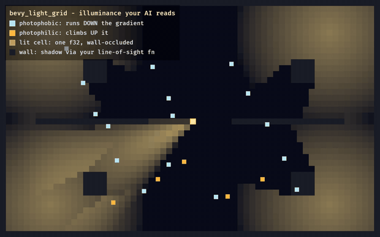

# bevy_light_grid

> ⚠️ **Vibe Coded.** Written by AI agents working from a human's direction, covered by tests rather than a line-by-line human review. Read the code before you rely on it for something you care about.

An illuminance grid that creature AI can read: "how bright is it here, and which way is brighter", computed on the CPU per cell, for games where things flee or seek the light.

[](https://github.com/bevy-coven/bevy_light_grid/actions/workflows/ci.yml) [](https://bevyengine.org) [](#who-and-licence)


*`examples/beam.rs`: every lit cell is one number this crate computed; the pale and amber dots run the same code on the same field, and only the sign of one argument makes one flee and the other chase.*

**Status:** experimental (not on crates.io yet) · Bevy 0.20

**Why:** your GPU lighting already knows how bright every pixel is, but the answer lives in a framebuffer that a creature deciding whether to scuttle into shadow cannot read; this crate answers the same question at cell resolution, in a form gameplay can sample and differentiate.

## Quick start

```toml
[dependencies]
bevy_light_grid = { git = "https://github.com/bevy-coven/bevy_light_grid" }
```

```rust
use bevy_light_grid::{FlashlightCone, LightGrid, light_push_at};
use bevy_math::{IVec2, Vec2};

let (w, h) = (16, 16);
let floor = (0..h).flat_map(|y| (0..w).map(move |x| IVec2::new(x, y)));
let mut field = LightGrid::new(w as usize, h as usize, floor);
let sees = |_from: IVec2, _to: IVec2| true; // your line-of-sight test: walls cast shadow

// The bake: static lamps as (cell, intensity, range in cells), rerun only when a lamp changes.
field.bake(&[(IVec2::new(4, 8), 1.0, 6.0)], sees);
// The compose: moving cones on top of the cached bake, every tick.
let torch = FlashlightCone { source: IVec2::new(12, 8), forward: Vec2::NEG_X, intensity: 1.0, range: 8.0, cone_cos: 0.8, edge_softness: 0.1 };
field.compose(&[torch], sees);

let cell = IVec2::new(6, 8);
let flee = light_push_at(&field, cell, -1.0); // a photophobic creature's push toward the dark
assert!(field.sample_cell(cell) > 0.0 && flee.is_finite());
```

## Try it

```sh
cargo run --example beam
```

The GIF above. `shadow` and `taxis` print the field as text, with no window or GPU.



*A frame of `beam`, with its legend: each lit cell is one `f32`, and walls shadow it through your line-of-sight function.*

## What you can do

- **Bake static lamps once and sweep moving cones every tick**: the bake is cached and the compose adds only the cones, so a walking flashlight is cheap: [the field](https://github.com/bevy-coven/bevy_light_grid/blob/main/docs/guide/the-field.md).
- **Cast shadows with your own map**: `bake` and `compose` take your line-of-sight closure, whatever your map is made of: [occlusion](https://github.com/bevy-coven/bevy_light_grid/blob/main/docs/guide/the-field.md#occlusion-is-yours).
- **Steer creatures by light**: `light_push_at` gives a push up or down the gradient, and is zero where the field is flat, so a creature in deep dark is left alone.
- **Tag behaviour with markers**: `Photophobic`, `Photophilic` and `Phototropic` components, and `phototropic_scale` for things that grow toward light: [the examples](https://github.com/bevy-coven/bevy_light_grid/blob/main/docs/guide/examples.md).
- **Keep it reproducible**: rock cells stay exactly zero and both passes visit only floor cells, bit-identical to a full scan: [determinism](https://github.com/bevy-coven/bevy_light_grid/blob/main/docs/guide/the-field.md#determinism).

## Part of the Coven

`bevy_light_grid` is one of the [Bevy Coven](https://github.com/bevy-coven) crates; [`bevy_lights`](https://github.com/bevy-coven/bevy_lights) places the fires and lamps a game draws, and this crate turns them into a field creatures read. How the Cauldron, the Coven's editor, uses it is on [its page in the book](https://bevy-coven.github.io/crates/bevy_light_grid.html#use-it-in-the-cauldron).

## Bevy compatibility

| `bevy_light_grid` | Bevy |
|---|---|
| 0.1 (git) | 0.20 |

## Learn more

- [The book page](https://bevy-coven.github.io/crates/bevy_light_grid.html).
- [`docs/guide/`](https://github.com/bevy-coven/bevy_light_grid/blob/main/docs/guide/README.md): the field, the examples and the references.
- [`examples/`](https://github.com/bevy-coven/bevy_light_grid/tree/main/examples).

## Who and licence

Maintained by [@Ladvien](https://github.com/Ladvien). It was split out of `foundation_vs_slop`'s `crates/bevy_light_grid` with its history, and is built on Bevy 0.20 here; issues and pull requests belong at [github.com/bevy-coven/bevy_light_grid/issues](https://github.com/bevy-coven/bevy_light_grid/issues), and contributions follow the org's [CONTRIBUTING.md](https://github.com/bevy-coven/.github/blob/main/CONTRIBUTING.md).

MIT OR Apache-2.0, at your option.
